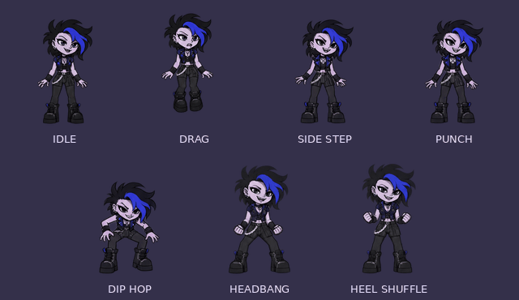
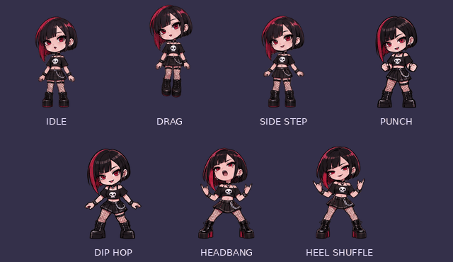

# Avatar Dance

Визуальное устройство для Ableton Live 12 с Max for Live. Встроенный робот танцует в такт, а пользовательский аватар проигрывается как циклическая последовательность PNG-кадров. Устройство можно поставить на аудиодорожку, в том числе на Master. Аудио проходит через стандартное соединение Max Audio Effect.

## Установка из исходников

1. Скачайте `Avatar Dance.maxpat` и `avatar-dance.js` в одну папку. В Max откройте **Options → File Preferences** и добавьте эту папку в пути поиска, чтобы скрипт находился и после сохранения устройства.
2. В Live добавьте **Max Audio Effect** на дорожку и нажмите кнопку редактирования устройства, чтобы открыть его в Max. Сохраните стандартные объекты `plugin~` и `plugout~` и соединения между ними.
3. Откройте `Avatar Dance.maxpat` в Max. Переключитесь из Presentation Mode в режим патча, разблокируйте патч, выделите все объекты и скопируйте их в Max Audio Effect.
4. В **Patcher Inspector** включите **Open in Presentation**. Сохраните устройство в User Library как `Avatar Dance.amxd` и заново загрузите его на дорожку.

## Аватары

- Поместите от 1 до 128 PNG-файлов в отдельную папку. Названия кадров состоят из четырёх цифр, например `0000.png`, `0001.png`, `0002.png`. У кадров должен быть одинаковый размер до 512 × 512 пикселей. Прозрачный фон сохраняется.
- Нажмите **Choose folder…** и выберите папку. Кадры проигрываются по возрастанию номера и рисуются по центру с сохранением пропорций.
- **frm/beat** задаёт количество кадров на четвертную долю. Например, 16 кадров при 4 кадрах на долю дают цикл в четыре доли. **Built-in** возвращает встроенного робота.

Кадр вычисляется из текущей позиции транспорта в долях. Смена темпа, перемотка и петля Live меняют ход анимации вместе с транспортом. При остановке аватар возвращается к первому кадру. Папку и скорость в этой версии нужно заново выбрать после повторной загрузки устройства.

## Тестовый аватар Blue Static

Blue Static — стилизованный готический персонаж в полный рост. [Лист спрайтов](avatars/blue-static/sprite-sheet.png) размером 1792 × 1792 состоит из семи рядов. В каждом ряду восемь прозрачных кадров 224 × 256, которые читаются слева направо.

| Ряд сверху | Папка | Анимация |
| --- | --- | --- |
| 1 | [Idle](avatars/blue-static/idle) | Спокойная стойка с морганием |
| 2 | [Drag](avatars/blue-static/drag) | Персонаж висит в воздухе и раскачивает ноги |
| 3 | [Side Step](avatars/blue-static/side-step) | Шаги в стороны с переносом веса |
| 4 | [Punch](avatars/blue-static/punch) | Удары рукой вверх с подъёмом колена |
| 5 | [Dip Hop](avatars/blue-static/dip-hop) | Выпад, прыжок и приземление |
| 6 | [Headbang](avatars/blue-static/headbang) | Кивки с резким взмахом волос |
| 7 | [Heel Shuffle](avatars/blue-static/heel-shuffle) | Касания пяткой и перекрёстные шаги |

В текущей версии устройства **Choose folder…** загружает одну папку кадров. При **4 frm/beat** цикл занимает две доли. Кадры Idle и Drag подготовлены для переключения по состоянию транспорта и мыши, которое пока не подключено.

## Аватар Кира

У Киры семь циклов по восемь кадров. Порядок рядов в [спрайт-листе](avatars/kira/sprite-sheet.png) совпадает с Blue Static. Чтобы загрузить цикл, выберите его подпапку в `avatars/kira` через **Choose folder…**.

## Проверка в Live

Нажмите Play и Stop, измените BPM во время воспроизведения, затем проверьте перемотку и переход петли. Загрузите папку с кадрами и проверьте, что смена скорости и возврат ко встроенному роботу работают в том же экземпляре устройства. Проверьте прохождение звука с включённым устройством.
