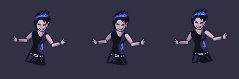

# Avatar Dance

Визуальное устройство для Ableton Live 12 с Max for Live. Встроенный робот танцует в такт, а пользовательский аватар проигрывается как циклическая последовательность PNG-кадров. Устройство можно поставить на аудиодорожку, в том числе на Master. Аудио проходит через стандартное соединение Max Audio Effect.

## Установка из исходников

1. Скачайте `Avatar Dance.maxpat` и `avatar-dance.js` в одну папку. В Max откройте **Options → File Preferences** и добавьте эту папку в пути поиска, чтобы скрипт находился и после сохранения устройства.
2. В Live добавьте **Max Audio Effect** на дорожку и нажмите кнопку редактирования устройства, чтобы открыть его в Max. Сохраните стандартные объекты `plugin~` и `plugout~` и соединения между ними.
3. Откройте `Avatar Dance.maxpat` в Max. Переключитесь из Presentation Mode в режим патча, разблокируйте патч, выделите все объекты и скопируйте их в Max Audio Effect.
4. В **Patcher Inspector** включите **Open in Presentation**. Сохраните устройство в User Library как `Avatar Dance.amxd` и заново загрузите его на дорожку.

## Аватары

- Поместите от 1 до 128 PNG-файлов в отдельную папку. Названия кадров состоят из четырёх цифр, например `0000.png`, `0001.png`, `0002.png`. У кадров должен быть одинаковый размер до 512 × 512 пикселей. Прозрачный фон сохраняется.
- Нажмите **Choose folder…** и выберите папку. Кадры проигрываются по возрастанию номера и рисуются по центру с сохранением пропорций.
- **frm/beat** задаёт количество кадров на четвертную долю. Например, 16 кадров при 4 кадрах на долю дают цикл в четыре доли. **Built-in** возвращает встроенного робота.

Кадр вычисляется из текущей позиции транспорта в долях. Смена темпа, перемотка и петля Live меняют ход анимации вместе с транспортом. При остановке аватар возвращается к первому кадру. Папку и скорость в этой версии нужно заново выбрать после повторной загрузки устройства.

## Тестовый аватар Nocturne

В папке [Nocturne](avatars/nocturne) три танцевальных цикла по мотивам движений из клипа Pearl Jam «Do the Evolution». Для **Choose folder…** выберите одну из подпапок.

- [Sway](avatars/nocturne/sway) — покачивание с переносом веса.
- [Reach](avatars/nocturne/reach) — взмах рукой над головой.
- [Dip](avatars/nocturne/dip) — резкий наклон и возврат.

Каждый цикл состоит из 24 прозрачных PNG-кадров размером 384 × 384. Установите **6 frm/beat**, чтобы цикл занимал четыре доли. [Ключевые позы](avatars/nocturne/poses.jpg) показаны в том же порядке сверху вниз.

Персонаж нарисован векторными контурами. Движение задают ключевые позы в [скрипте рендера](avatars/nocturne/render.py). Чтобы пересобрать кадры, установите CairoSVG и Pillow и запустите `python avatars/nocturne/render.py avatars/nocturne` из корня репозитория.

## Проверка в Live

Нажмите Play и Stop, измените BPM во время воспроизведения, затем проверьте перемотку и переход петли. Загрузите папку с кадрами и проверьте, что смена скорости и возврат ко встроенному роботу работают в том же экземпляре устройства. Проверьте прохождение звука с включённым устройством.
