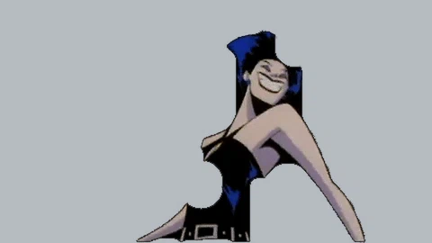

# Кадры из GIF «Do the Evolution»

[Лист всех кадров с номерами и таймкодами](contact-sheet.jpg) поможет выбрать границы фрагментов.

В папке `frames` 107 прозрачных PNG размером 960 × 540. Сохранены исходная последовательность, границы кадра и пустые кадры между сценами. В `timing.csv` указаны начальная отметка и длительность каждого кадра в миллисекундах. Значение `blank=1` отмечает пустой кадр. Общая длительность составляет 7140 мс.

Исходник из архива имел размер 480 × 270. Фон удалён по маске силуэта, изображение увеличено вдвое и слегка повышена резкость. Там, где платье или волосы сливаются с чёрным фоном, контур приблизительный.

При нарезке для Avatar Dance используйте одну область обрезки на весь фрагмент, чтобы избежать скачков положения. Текущий загрузчик принимает PNG до 512 × 512, поэтому мастер-кадры нужно кадрировать или уменьшить перед импортом. В самом устройстве скорость задаётся в кадрах на долю.
